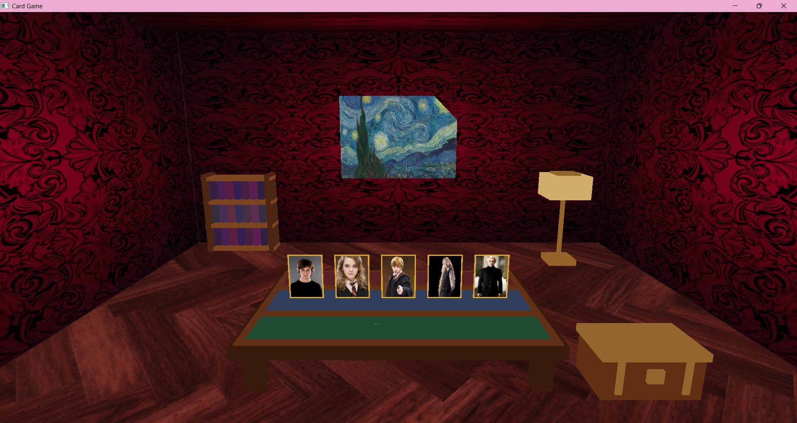

# CardGame 🎴

A 3D Card Game Scene developed using C++ and OpenGL.

## 📌 About the Project

CardGame is a 3D graphics project that presents an interactive card game environment inside a textured room.

The scene combines 3D objects, textures, lighting, and image-based cards to create a visually detailed environment.

## ✨ Features

- 3D room environment.
- Textured walls and wooden floor.
- 3D furniture, including a table, bookshelf, lamp, and drawer.
- Image-textured playing cards.
- Interactive card movement.
- Custom OpenGL shaders.

## 🛠️ Technologies Used

- C++
- OpenGL
- GLSL
- CMake

## 📁 Project Structure

- `main.cpp` – Main entry point.
- `Game.cpp / Game.hpp` – Game logic.
- `Room.cpp / Room.hpp` – Room environment.
- `Table.cpp / Table.hpp` – Game table.
- `Card.cpp / Card.hpp` – Card objects.
- `shaders/` – Vertex and fragment shaders.
- `textures/` – Images and textures used in the scene.

## 🖼️ Project Preview

## 👩‍💻 Author

Created as an OpenGL Computer Graphics project.
